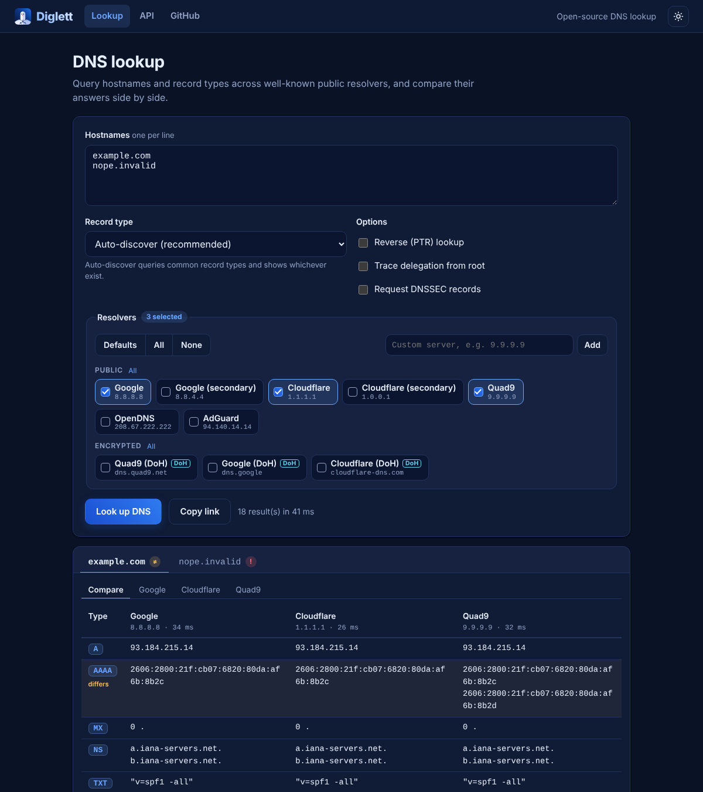
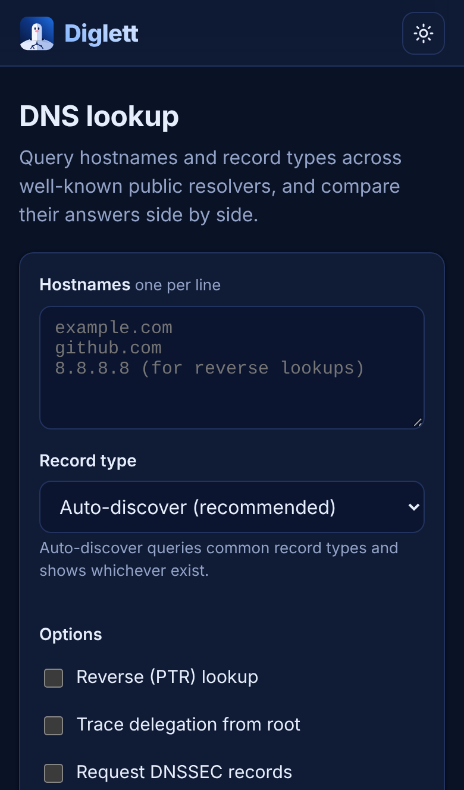

<p align="center">
  
</p>

<h1 align="center">Diglett</h1>

<p align="center">
  <strong>Dig into DNS from your browser.</strong><br>
  A self-hosted, open-source web DNS lookup tool and API.
</p>

<p align="center">
  <a href="https://github.com/zollo/diglett/actions/workflows/ci.yml"></a>
  <a href="https://github.com/zollo/diglett/releases"></a>
</p>

---

Diglett queries one or more hostnames for one or more record types against a
choice of well-known public DNS resolvers, and lays the answers side by side so
you can see where resolvers disagree. Think of it as a
[digwebinterface.com](https://www.digwebinterface.com) you run yourself: one
tiny container, no database, and a JSON API behind every button.

<p align="center">
  
</p>

## Features

**Lookups**
- Many hostnames, record types and resolvers in one request, run concurrently.
- **Auto-discover**: leave the type unset and Diglett probes the common record
  types (A, AAAA, CNAME, MX, NS, TXT, SOA, CAA, SRV) and shows whichever exist.
- **Reverse (PTR) lookups**, `+trace`-style **delegation tracing** from the
  root servers, and **DNSSEC** record requests.

**Compare resolvers**
- Google, Cloudflare, Quad9, OpenDNS and AdGuard built in, plus DNS-over-HTTPS
  variants. Add your own in config, or query any plain DNS server ad hoc.
- One tab per hostname with a side-by-side table that flags rows where
  resolvers **differ**, and a detail tab per resolver.
- UDP (with TCP fallback), TCP, DoT and DoH transports.

**Made to share**
- Every query is a link: **Copy link** puts the hostnames, type and resolvers
  in the URL, and opening it runs the lookup again.
- A dark blue theme by default with a light mode toggle, and a layout that
  works on a phone.

**API-first**
- The web UI is just a client of the same unauthenticated JSON API, so
  anything it does works from `curl`, including dig-style plain text output.

**Small and safe**
- One static Go binary in a distroless, read-only, non-root container.
- Ad-hoc resolvers are plain DNS servers only, so the public API can't be used
  for server-side request forgery.

<p align="center">
  
</p>

## Self-hosting

Diglett is a single Go binary with the web UI embedded. Multi-arch images
(`linux/amd64`, `linux/arm64`) are published to GHCR as `ghcr.io/zollo/diglett`
for every release.

### Docker

```bash
docker run --rm -p 8080:8080 ghcr.io/zollo/diglett:latest
```

Open http://localhost:8080.

### Docker Compose

```bash
docker compose up -d
```

[`docker-compose.yml`](docker-compose.yml) runs the container read-only, with
no capabilities and no new privileges.

### TrueNAS SCALE

[`deploy/truenas/`](deploy/truenas/) has both a Docker Compose custom app
(Electric Eel 24.10+) and a Helm chart with a TrueNAS GUI form. See its
[README](deploy/truenas/README.md).

### Kubernetes (Helm)

```bash
helm install diglett oci://ghcr.io/zollo/charts/diglett --version <release> \
  --namespace diglett --create-namespace
```

If the GHCR packages are private, run `helm registry login ghcr.io` first. See
[`charts/diglett/`](charts/diglett/) for values, ingress, custom resolvers and
pulling from a private registry.

### From source

```bash
go run .            # listens on :8080
make build && ./diglett -config config.yaml
```

### Container images

Public multi-arch images (`linux/amd64` + `linux/arm64`) are published to the
GitHub Container Registry by CI:

```
ghcr.io/zollo/diglett
```

Every push to `main` cuts a new release (see [Releases & versioning](#releases--versioning)),
so each published image is tagged:

| Tag | Points at |
| --- | --- |
| `latest` | The newest release. |
| `X.Y.Z` | An exact release, for reproducible deploys. |
| `X.Y` | The newest patch release in a minor line. |
| `sha-<short>` | The image built from a specific commit. |

Pin `X.Y.Z` for reproducible deploys, `X.Y` to float within a minor line, or
`latest` for the newest. Images are cosign-signed and carry a build-provenance
attestation.

## Configuration

Configuration is layered: **built-in defaults → optional YAML file → environment
variables** (env always wins). Point at a file with `-config path.yaml` or
`DIGLETT_CONFIG=path.yaml`. See [`config.example.yaml`](./config.example.yaml)
for a fully commented reference.

### Environment variables

| Variable | Default | Description |
| --- | --- | --- |
| `DIGLETT_CONFIG` | — | Path to a YAML config file. |
| `DIGLETT_HOST` | `0.0.0.0` | Listen address. |
| `DIGLETT_PORT` | `8080` | Listen port. |
| `DIGLETT_TRUSTED_PROXY` | `false` | Honour `X-Forwarded-For` in logs. |
| `DIGLETT_TIMEOUT` | `5s` | Per-exchange DNS timeout. |
| `DIGLETT_CONCURRENCY` | `12` | Max simultaneous exchanges per request. |
| `DIGLETT_MAX_HOSTNAMES` | `100` | Max hostnames per request (0 = unlimited). |
| `DIGLETT_MAX_RESOLVERS` | `20` | Max resolvers per request (0 = unlimited). |
| `DIGLETT_ALLOW_CUSTOM_RESOLVERS` | `true` | Allow ad-hoc plain-DNS resolver addresses (see note). |
| `DIGLETT_DEFAULT_RESOLVERS` | `google,cloudflare,quad9` | Pre-selected resolver IDs. |
| `DIGLETT_RESOLVERS` | built-in list | Inline resolver definitions (see below). |

`DIGLETT_RESOLVERS` is a comma-separated list of resolvers, each in the compact
form `id|Name|address|protocol|group`:

```bash
DIGLETT_RESOLVERS="google|Google|8.8.8.8|udp|Public, cf-doh|Cloudflare DoH|https://cloudflare-dns.com/dns-query|https|Encrypted"
```

### Resolver protocols

| `protocol` | Meaning | `address` form |
| --- | --- | --- |
| `udp` (default) | Plain UDP, falls back to TCP on truncation | `host` or `host:port` |
| `tcp` | Plain TCP | `host` or `host:port` |
| `tls` | DNS-over-TLS (DoT) | `host` or `host:port` (default `:853`) |
| `https` | DNS-over-HTTPS (DoH) | full URL, e.g. `https://dns.google/dns-query` |

> **Security note.** `DIGLETT_ALLOW_CUSTOM_RESOLVERS` only permits ad-hoc
> resolvers that are **plain DNS servers** (an IP or host, queried over
> UDP/TCP). DoH/DoT endpoints — which involve the server making an HTTP(S)
> request — can only be defined in the configured resolver set and referenced
> by `id`; arbitrary URLs are rejected so the unauthenticated API cannot be
> abused as a server-side request forgery (SSRF) vector. Set it to `false` to
> disallow ad-hoc resolvers entirely.

## API

Diglett is API-first: the web UI calls exactly these endpoints, and so can you.
No authentication is required.

### `GET|POST /api/lookup`

Perform a lookup. `POST` takes a JSON body; `GET` takes query parameters (handy
for `curl` and shareable links).

**JSON body (POST):**

```jsonc
{
  "hostnames": ["example.com", "github.com"],
  "type": "MX",                 // omit or use "AUTO" for auto-discovery
  "resolvers": ["google", "cloudflare"], // IDs or literal addresses
  "reverse": false,             // treat hostnames as IPs, do PTR lookups
  "trace": false,               // iterative trace from the root servers
  "dnssec": false               // set the DO bit, request DNSSEC records
}
```

**Query parameters (GET):** `name`/`host`/`q` (repeatable or comma/space/newline
separated), `type`, `resolvers`, `reverse`, `trace`, `dnssec`, and `text=1` for
a plain-text, dig-style response.

**Examples:**

```bash
BASE=http://localhost:8080

# Auto-discover all common records for a hostname
curl "$BASE/api/lookup?name=example.com"

# A specific type across two resolvers (JSON)
curl -X POST "$BASE/api/lookup" -H 'Content-Type: application/json' -d '{
  "hostnames": ["example.com", "github.com"],
  "type": "MX",
  "resolvers": ["google", "cloudflare"]
}'

# Reverse lookup, terminal-friendly text output
curl "$BASE/api/lookup?name=8.8.8.8&reverse=1&text=1"

# Query an ad-hoc resolver by address
curl "$BASE/api/lookup?name=example.com&type=A&resolvers=9.9.9.9"
```

**Response shape (JSON):**

```jsonc
{
  "queries": [
    {
      "hostname": "example.com",
      "type": "A",
      "resolver": { "id": "google", "name": "Google", "address": "8.8.8.8", "protocol": "udp" },
      "status": "NOERROR",
      "answers": [
        { "name": "example.com.", "type": "A", "class": "IN", "ttl": 300, "data": "93.184.216.34" }
      ],
      "authority": [],
      "additional": [],
      "query_time_ms": 20,
      "server": "8.8.8.8:53",
      "protocol": "udp",
      "raw": ";; Query: example.com  Type: A ..."
    }
  ],
  "duration_ms": 21
}
```

### `GET /api/resolvers`

Lists the configured resolvers, the default selection, and the supported record
types — this is what populates the UI.

### `GET /api/version` · `GET /healthz`

Version info and a health probe.

## Development

```bash
make test    # go test -race ./...
make vet     # go vet ./...
make fmt     # gofmt -w .
make run     # run locally on :8080
make docker  # build the container image
```

The web UI (`web/static/`) is plain HTML, CSS and JavaScript with no build
step, embedded into the binary with `go:embed`. The logo is
[`web/static/icons/logo.svg`](web/static/icons/logo.svg); the PNG icons,
`favicon.ico` and `apple-touch-icon.png` next to it are rendered from it.

### Releases & versioning

Diglett uses [Semantic Versioning](https://semver.org/) driven by
[Conventional Commits](https://www.conventionalcommits.org/), automated in
[`CI`](./.github/workflows/ci.yml):

- **Contribute via PRs with Conventional Commit titles.** A `PR Title` check
  ([`pr-title.yml`](./.github/workflows/pr-title.yml)) enforces the format, e.g.
  `feat: add X`, `fix: correct Y`, `docs: …`, `ci: …`. The repo squash-merges
  with the **PR title as the commit subject**, so the title determines the
  version bump.
- **On every merge to `main`**, CI computes the next version from the commits
  since the last tag — `feat:` → minor, `fix:` → patch, `type!:` (e.g.
  `feat!:`) → major, otherwise patch — then tags it, publishes a **GitHub
  Release** with auto-generated notes, builds/pushes the signed image, and
  publishes the Helm chart at the same version to
  `oci://ghcr.io/zollo/charts/diglett` (also attached to the release, with the
  TrueNAS chart as `diglett-truenas-X.Y.Z.tgz`).
- The **first** release is seeded at `v1.0.0`.
- Pull requests run the tests and build the image for both architectures
  without pushing it.

> Repo setting to enable: **Settings → General → Pull Requests → Allow squash
> merging**, with **“Default to pull request title”** for the squash commit
> message. That makes the enforced PR title the commit subject the versioner
> reads. (This mirrors `zollo/azuregos` and `zollo/certainly`.)

See [CONTRIBUTING.md](./CONTRIBUTING.md) for the commit types and their effect
on the version.

### Project layout

```
main.go                     entrypoint / flag parsing
internal/config             layered configuration (defaults, YAML, env)
internal/lookup             DNS query engine (transports, discovery, trace)
internal/server             HTTP API + embedded UI serving
web/static                  the web UI and icons (embedded)
charts/diglett              Helm chart for Kubernetes
deploy/truenas              TrueNAS SCALE Helm chart + custom-app compose
```

**Stack:** Go · [miekg/dns](https://github.com/miekg/dns) · vanilla HTML/CSS/JS ·
distroless container · Helm

## License

[MIT](LICENSE).
